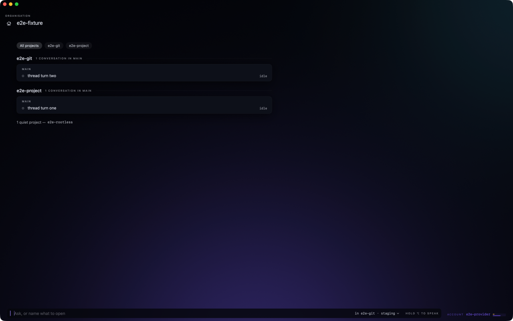
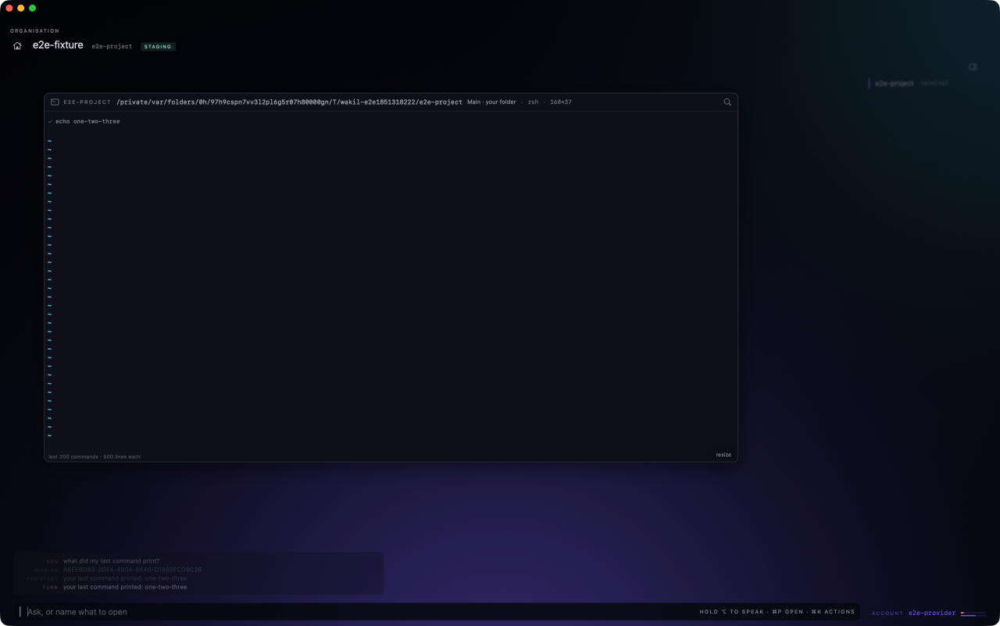
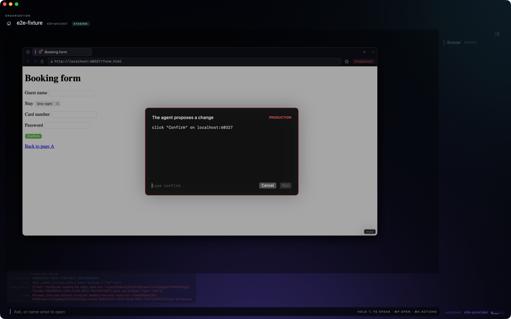
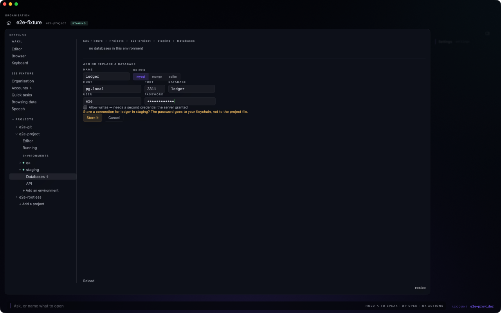
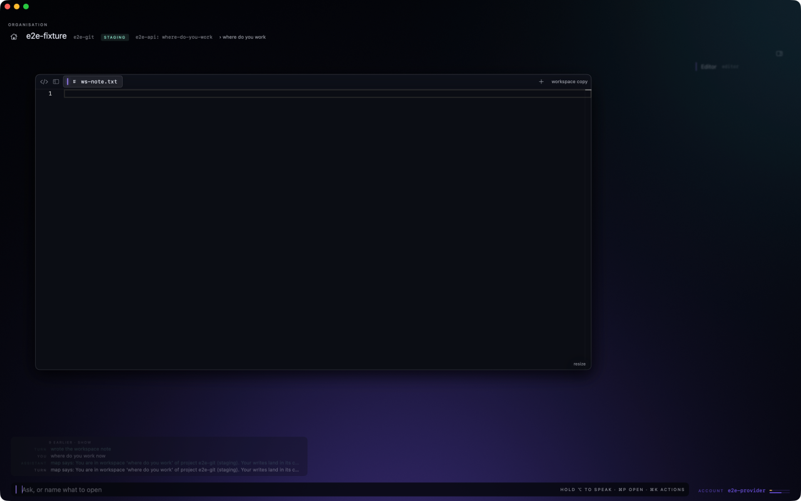
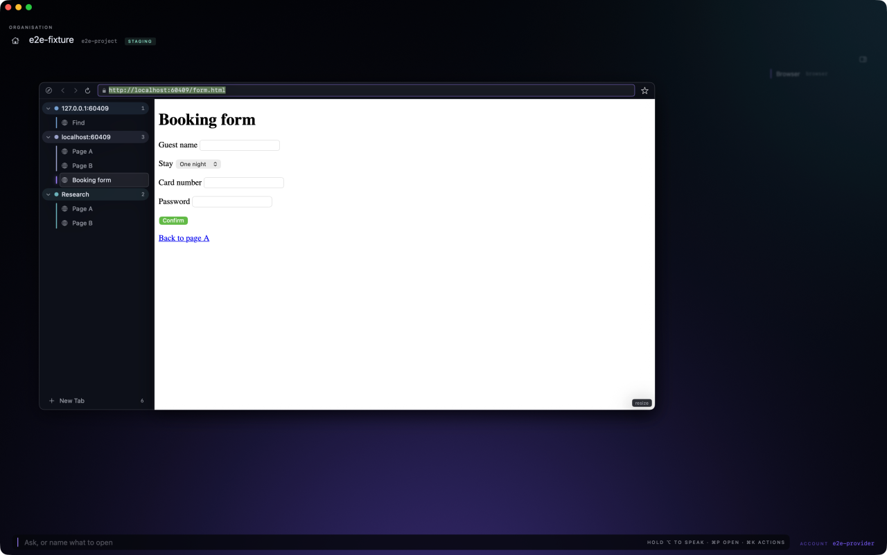
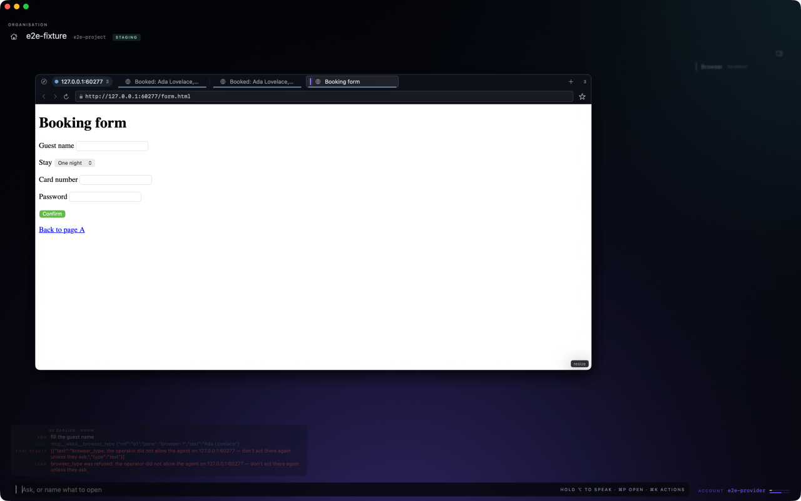
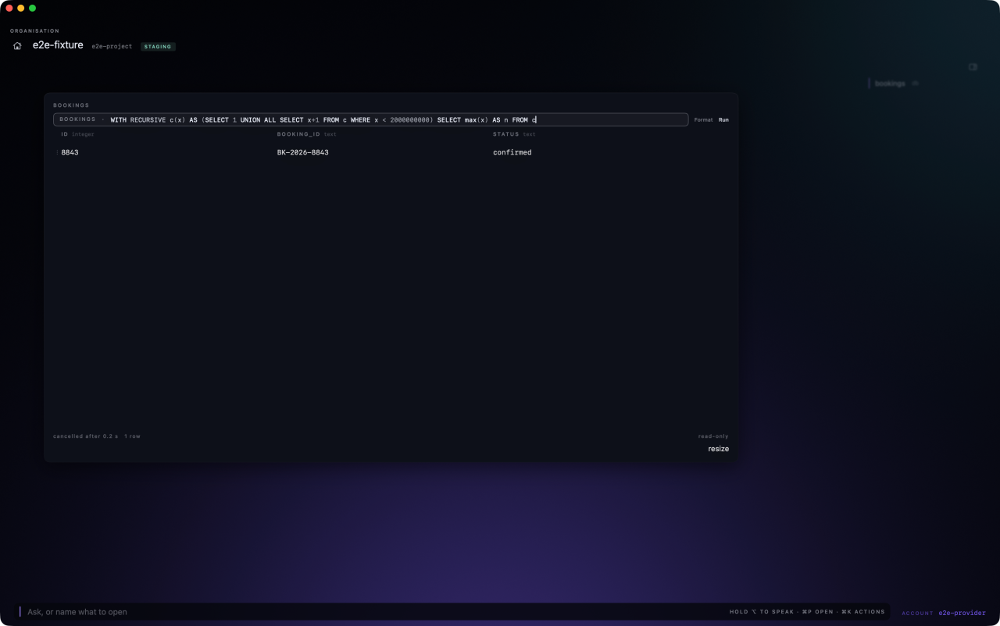
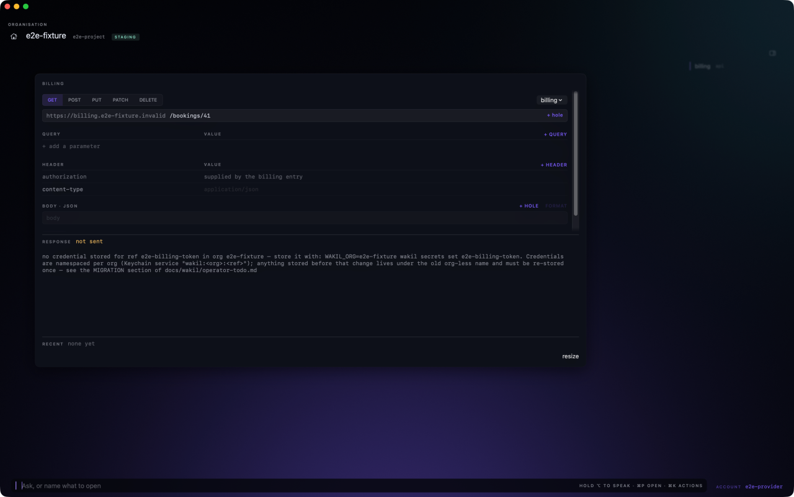
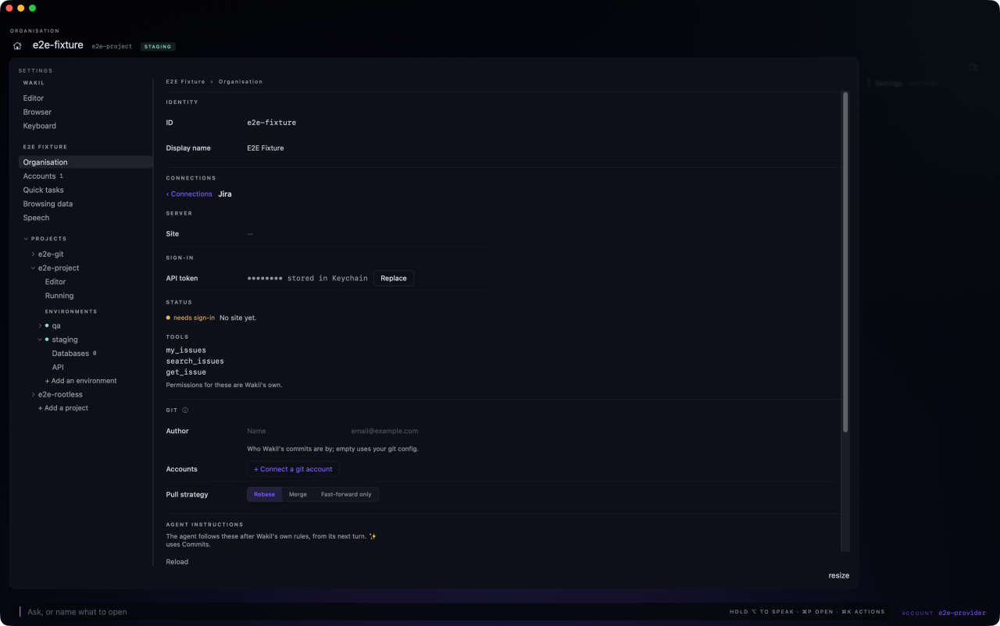

# Wakil

A native macOS workspace where your organization, project and environment are ambient:
every tool, and the AI agent working beside you, already knows which one you mean.

You never tell Wakil *which* Jira, *which* database or *which* Claude account. You tell it
what you want.

> **Status: archived.** I built Wakil for myself across two months (September to November
> 2026) and I'm not continuing it. It's published as a record of the work: the design
> decisions, the safety model and the test harness are the interesting parts. It builds and
> runs, but expect sharp edges.



## The idea

Wakil holds one active context, an **(organization, project, environment)**, and every pane
resolves against it: a database client, an API client, a terminal, an editor with git, a
browser, tickets and pull requests, and a conversation with an agent. Switch the context and
everything follows.

The test every feature had to pass:

> A feature earns its place in Wakil only when its absence forces you to leave.

**By the numbers:** about 245k lines of Swift, 122k lines of Go, 10 MCP servers, 400 end-to-end
checks, and 110 numbered design decisions, each with its reasoning and the condition that would
reverse it.

## What I'm proudest of

### 1. Dual-driven panes: one action path for human and agent

Every pane exposes an enumerated **action registry**. A button click, a keyboard shortcut, a
palette command and an agent's tool call all dispatch the same action on the same state.
There is no second code path to a pane's state, by rule.

- Adding a button makes it agent-addressable; adding a capability puts it in the UI. Drift
  between "what the UI can do" and "what the agent can do" is structurally impossible.
- The agent can read any pane, so "this table" or "that response" resolves against what is
  actually on screen.
- Every dispatch passes one chokepoint, which gives a single journal (with undo) and a single
  place to enforce safety.

Wakil serves the registry to the agent as its own MCP surface, over a `0700` unix socket rather
than an HTTP port. File permissions beat a bearer token on a port.



### 2. The write-price gate

The safety model is "read-only until a write earns its way in." Writes are added one adapter at
a time, each with a written justification and an explicit list of what stays refused. Twelve
have earned in: SQL row mutation, HTTP mutation methods, file writes, git (local and remote),
acting in a web page, and a few more.

Each write then declares its own **price**, a pair of answers for production and for everything
else: `allow`, `gate` (typed confirmation) or `block`. One policy function, `writeGate`, reads
the action's price, who asked (operator or agent, typed or spoken) and the active environment,
and answers allow, gate or block. Everything passes through it.

- **The price rides on the action, not its kind** (Decision 25). A `DELETE` row and a file save
  are both "writes" but carry very different risk. Pricing each action keeps that distinction
  without inventing new categories that other code could silently mishandle.
- **Production is declared, not guessed** (Decision 26). An environment named `prod` without a
  `production: true` flag is flagged once, rather than widening a name list that only ever
  guesses.
- **Voice can never confirm a gated write** (Invariant 7). Speech may propose; only typing
  `confirm` executes.
- **Refused by construction.** The agent's allowed tools are derived from the registry as
  read and control actions only. Mutating actions are structurally absent from the list, and
  the permission bridge denies by default (Decisions 66 and 67).
- **Still refused, permanently:** schema changes (every DDL verb), requests leaving an API
  entry's base URL (redirects included), and the agent typing into password or card fields.



### 3. Organizations are credential boundaries

An organization owns its secrets, stored in the macOS Keychain under `wakil:<org>:<ref>`.
Cross-org bleed is made impossible by the service name, the per-org directory and a check in
the resolver, not merely avoided.

- **Credentials at the org, scope at the project.** Switching projects never re-asks for auth.
- **A Claude account may be shared across orgs; an org's credentials never are** (Decision 22).
  What's shared is who pays, never whose databases.
- **Only Go writes the Keychain**, and the agent's child process is built from an empty
  environment, so a stray `ANTHROPIC_API_KEY` can never shadow a subscription.
- Saved passwords are filled into web pages only on the operator's press, never the agent's.



### 4. The agent harness

Wakil never assumes which agent it runs. **Nothing outside the harness adapter knows Claude
exists** (Invariant 1).

- **Two independent axes: harness and provider** (Decision 16). The harness runs the loop,
  tools and context; the provider is what it talks to and how it authenticates. Claude Code is
  the first harness; it can reach a third-party or local model through `ANTHROPIC_BASE_URL`
  with no change to how it's launched.
- **Drives the `claude` CLI directly** over `stream-json`, not through the Agent SDK. Each
  provider gets its own config directory, which isolates settings, history, plugins and MCP
  OAuth: one whole credential boundary per provider.
- **Many agents at once, each in its own place** (Decision 41). Switching tears nothing down.
- **Workspaces** (Decision 110). Main is for reading. An agent's first change gives its
  conversation a workspace with a git worktree per repo it touches, so two agents never stage
  each other's hunks or move the tree under each other.



### 5. Quick tasks go to a cheaper, faster model

Not everything needs the main agent. Short one-shot jobs (ghost-text completions in the
database query line, commit message drafts, conversation titles, and the "fast path" for
navigation commands) run through a separate seam, `QuickModel`, on the organization's
**quick provider**: a warm Claude session, or a small local model such as Qwen2.5-Coder 1.5B
behind `llama-server` (Decision 42).

- **Measured, not assumed:** a one-shot `claude -p` took ~4.5 s, a warm session 1.0 to 1.8 s,
  and the local 1.5B model 30 to 210 ms.
- **The fast path** lets the small model answer a composer line with exactly one action from a
  fixed list of 26 navigation actions, and no writes. Wakil runs it only if the action is on the
  list, its parameters fit the schema and every name exists. A late answer or any doubt sends
  the line to the main agent unchanged (Decision 10).
- **Learned the hard way:** the 1.5B model answered "delete the draft bookings" by closing a
  pane. Lines starting with delete, drop, remove, truncate and similar words now skip the small
  model entirely (Decision 79).
- **Only the minimum leaves the machine** (Decision 78): column names of at most five tables
  for ghost-text, the staged diff for a commit draft. Never rows, never file contents.
- **Never a quick task:** the write gate, statement classification, or anything touching
  credentials.

### 6. Voice: Apple's on-device speech-to-text instead of Whisper

Voice is a **transport, not a command language** (Decision 10). Speech-to-text produces exactly
the string the text box would send: one code path, no grammar, no intent parser. Capture is
push-to-talk, never an always-on wake word (Decision 11).

The engine choice came from a probe (`docs/wakil/2d-stt-probe.md`) on 29 real identifiers
(table names, ticket keys, branch names):

| Engine | Exact | After name folding | Latency |
|---|---|---|---|
| Apple `SpeechAnalyzer` (on-device, macOS 26) | 4 / 29 | 14 / 29 | 0.07 to 0.48 s |
| WhisperKit large-v3-turbo | 3 / 29 | 15 / 29 | 5.8 to 7.2 s |

The engines were level on accuracy, but WhisperKit was about 10× slower and a 950 MB download,
so **Apple's on-device recognizer is the default** (Decision 18). WhisperKit stays selectable,
cloud STT is opt-in per organization, and both sit behind one Swift protocol.

The bigger finding was that *both* engines mangle identifiers the same way, so a better engine
wouldn't fix it. Instead, Wakil folds case and separators, matches the names in scope, and hands
the agent the candidates as a hint under the unchanged turn. The agent makes the call.

### 7. A test harness that proves it can fail

400 end-to-end checks drive the real app through the macOS accessibility tree, against seeded
fixture data and a scripted stand-in agent.

- **Every new check must be shown to fail** against the code before the change (`make e2e-new`).
- **Retrodiction:** to prove the harness could catch the bugs it was built for, known defects
  were patched back into the source one at a time, and the check covering each one had to go
  red (`docs/wakil/agent-e2e-retrodiction.md`).
- **Nine interaction rules** (`PRODUCT.md`) govern every control (focus, confirmation, where
  you land after an action), and every UI change is checked against them.

## More screens

| | |
|---|---|
|  |  |
|  |  |
|  | |

## How it's built

```
app/                 Swift app: WakilKit (testable logic) and WakilApp (drawing, Metal)
cmd/                 one MCP server per capability: wakil-db, wakil-git, wakil-http, ...
internal/wakilcore/  the headless capability layer those servers share
e2e/                 the accessibility-driven harness, its checks and the scripted agent
```

The Go capability layer is headless and usable without the app; the Swift app owns pane state
and actions. Swift 6 and SwiftUI with Metal for the shell, a vendored Monaco editor, SwiftTerm's
headless engine for the terminal, and WebKit with one profile per organization for the browser.

## What I learned

- **Write the decision down with what would reverse it.** 110 decisions, each with a "Reverse
  if" line, made it cheap to revisit choices without re-arguing them.
- **Probe before deciding.** The speech-to-text, Keychain, picture-in-picture and permission
  prompt probes each overturned an assumption I'd have built on.
- **Safety is easier as structure than as checks.** Deriving the agent's allowed tools from the
  registry, and building its environment from nothing, removed whole classes of mistakes.
- **Agents need a test harness they can't fool.** Making each new check prove it can fail did
  more for reliability than adding checks.
- **Scope grows by gravity.** "Its absence forces you to leave" kept me honest for a while; a
  workspace that replaces every tool is still a lot of tools.

## Build and run

Requirements: macOS 14.4 or later (voice uses macOS 26's `SpeechAnalyzer` when available), Xcode
command-line tools with Swift 6 and the Metal compiler, Go 1.27, and the
[`claude`](https://docs.anthropic.com/en/docs/claude-code) CLI for the agent.

```sh
make build        # the Go tools, into bin/
make app-bundle   # bin/ plus the Swift app, into app/Wakil.app (unsigned)
open app/Wakil.app
```

Tests:

```sh
make test         # Go suite and the charter's word-limit check
make build app-test   # Swift suite; it runs against whatever bin/ holds, so build first
make test-live    # engine-backed tests against MySQL and Mongo in Docker
make e2e          # the end-to-end checks (drives the app on screen)
```

Screenshots show the e2e fixture's fake organization and projects (`e2e-fixture`,
`e2e-project`), not real data.

## Docs

| Read | For |
|---|---|
| [`docs/wakil/north-star.md`](docs/wakil/north-star.md) | The charter: what Wakil is, its binding invariants, its non-goals |
| [`docs/wakil/decisions.md`](docs/wakil/decisions.md) | All 110 decisions, with why and when to reverse |
| [`docs/architecture/README.md`](docs/architecture/README.md) | The map of the code, Swift and Go |
| [`PRODUCT.md`](PRODUCT.md) | Users, brand and the interaction rules every control follows |
| [`CONTRIBUTING.md`](CONTRIBUTING.md) | Where code goes, recipes, and the tests each change needs |
| [`docs/agents/workflow.md`](docs/agents/workflow.md) | How work moved from design to a merged change |

## License

[MIT](LICENSE). Bundled third-party code keeps its own license, such as Monaco in
`app/Resources/monaco/`.
