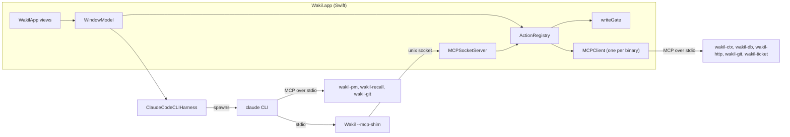

# Wakil architecture

The map of the code, Swift and Go. Every fact here names the file or type it comes from, so it can
be checked; where a rule exists, it names the test that enforces it or says *convention*.

Read in this order:

| File | Answers |
|---|---|
| this file | What the pieces are and how they talk |
| [runtime.md](runtime.md) | Who creates and owns what, how Go binaries are found, and the shutdown order |
| [flows.md](flows.md) | What happens, function by function, on a click, an agent tool call and an org switch |
| [wakilkit.md](wakilkit.md) | Every `WakilKit` folder: its job, key types, what it may use, its tests; the layering rules |
| [wakilapp.md](wakilapp.md) | The executable: `main.swift`'s modes, the scene, the canvas and each view |
| [go.md](go.md) | Every Go binary and its tools; `internal/wakilcore` by area; the Go layering rules |
| [state.md](state.md) | Everything on disk and in the Keychain, what lives only in memory, what an org switch resets |
| [testing.md](testing.md) | The test suites, the structural tests, e2e, acceptance runbooks and the make targets |

Then `CONTRIBUTING.md` at the repository root: where new code goes, recipes, and the tests each
change needs.

## The pieces

- **`WakilApp`** (`app/Sources/WakilApp/`) draws. Its views read `WindowModel` and dispatch through
  it. It has no test target, so nothing worth asserting is decided there.
- **`WakilKit`** (`app/Sources/WakilKit/`) is everything else in Swift: `WindowModel`, the stores,
  `ActionRegistry`, the gate, the MCP client and server, and the harness.
- **`ActionRegistry.dispatch`** is the single path for every state change, whether a control, the
  agent, or a `--dispatch` script asked. It asks `writeGate` first and journals every outcome.
- **The Go binaries** (`cmd/`, `internal/`) are headless capabilities behind MCP. The window starts
  five of them (`WakilWiring.build`). The agent's `claude` process starts the agent-facing ones
  (`agentFacingServers`). `wakil-git` is started by both. `wakil-ticket` is window-owned only: not in `agentFacingServers`, so the agent reaches it through registry actions.
- **What needs the operator** is counted from the last `ticket_in_flight` read (`ticketNeeds`), never stored; the rail, the Ticket label, the Landing and ⌘P read it. A **handed** conversation (Hand to agent, Decision 49) is an ordinary one started off screen; the registry asks a `handedLookup` beside the production lookup, and `handedAgentPrice` raises its push, sync, publish, merge and rebase.
- **`wakil-connect`** is one process per connection of the launching place's organization, started by the agent's
  `claude` process (`AgentConnectionsBox` builds its config). It fronts the organization's own MCP
  server, injects the credentials, and gates every call. See `go.md`.
- **The agent** is the `claude` CLI, driven by `ClaudeCodeCLIHarness` (`Harness/`). It reaches
  Wakil's own actions only through the shim.
- **Quick tasks** (one-shot model calls, ghost-text first) go through `QuickTasks` (`App/QuickTasks.swift`),
  which picks a `QuickModel` (`Harness/QuickModel.swift`): a warm `claude` session or a local
  llama.cpp-style endpoint. Decision 42.

## How they talk

- **MCP over stdio, newline-framed JSON-RPC, for every Go binary.** `MCPClient`
  (`MCP/MCPClient.swift`) spawns one binary, performs the `initialize` handshake in `start()`, and
  calls tools with `callTool`. Each binary serves with `mcp.StdioTransport`.
- **The shim.** The `claude` CLI can only spawn stdio MCP servers, and the app is already running.
  So the agent's MCP config (`agentMCPConfigJSON`) names the app's own executable with
  `--mcp-shim --socket <path>` as the server called `wakil`. `runShim` (`MCP/Shim.swift`) copies
  bytes between its stdio and its agent session's own unix socket and parses nothing. `MCPSocketServer`
  (`MCP/MCPServer.swift`) answers each frame on the socket with `handle`.
- **The agent's tools are the registry's actions.** `tools/list` on the socket is the registry's
  action set, plus three hand-written tools answered in the window: `read_pane` (what a pane shows,
  from `PaneStore`), `read_layout` (what is on screen, from `LayoutStore`), and `approve_tool_use`
  (the CLI's permission prompt, answered by `permissionDecision`).
- **The approval socket.** Each conversation has a second unix socket beside its agent socket,
  `<dir>/<session id>-approval.sock` (`ConnectionApprovalServer`, `Gate/ConnectionApproval.swift`).
  `wakil-connect` asks it before a gated call. It can only ask: a call it cannot allow outright
  parks on the confirmation broker for the operator, and it never approves by itself.
  `wakil-connect` reads the connection's record from `org.json` at every call. When the connection
  is gone, it tells the socket (`"removed": true`) and refuses the call. The app refuses too when
  its own list (`AgentConnectionsBox.stillHas`) no longer has the connection, and journals the
  refusal `connection-removed`.
- **A connection change restarts the open conversations.** `AgentConnectionsBox` keeps a revision
  per organization. It moves when a connection is added, removed or renamed, when a server field
  changes, or when a sign-in changes. It does not move for an Allow agent tick. Each session
  records the revision it launched at. At a conversation's next message, if the agent is between
  turns (`WindowModel.connectionsRestartDue`), `send` fork-resumes it through `resume`, so the new
  launch's config has the current connections. Then the message goes to the new agent. A
  conversation mid-turn, or with a call on the plane, restarts at the first message after that.
- **The e2e harness socket.** Only the staged e2e fixture (bundle id `dev.wakil.e2e`) opens a
  third socket beside each agent socket, `<dir>/<session id>-e2e.sock`, mode 0600
  (`startHarnessSocket`, `MCP/HarnessChannel.swift`). It serves only the operator-only actions,
  dispatched with origin `.debug`, so the harness can drive them; the agent socket keeps refusing
  them. Its path is derived from the agent socket's, so it is not secret, and no agent's
  `--mcp-config` or environment lists it. What protects it is the bundle-id gate and mode 0600.
  A shipped Wakil (`dev.wakil.app`) never opens it, unless its `Info.plist` is edited. The threat
  model is in `docs/wakil/decisions.md`, "a connection's tool, allowed by the operator". If the socket
  fails to start, the status says so, and the agent socket's `initialize` carries the reason
  (`wakil/harnessFailure`).
- **`ctx_config_tree_for`** (`StandardActions.swift`) reads a named organization's config tree for a
  launch's connections. It is operator-only, never the agent's; `ctx_config_tree` stays the active
  organization's.
- **The `wakil` CLI** is run as a plain subprocess by the window to read and mint account
  credentials (`WakilCLICredentialsLookup`, `WakilCLIProviderMint`).

## Where to go next

- `docs/wakil/north-star.md` — the charter. §4 Invariants are binding; §9 is the glossary.
- `PRODUCT.md` §Interaction Rules — how every control behaves.
- `docs/wakil/decisions.md` — decision records.
- `docs/wakil/org-and-provider-model.md` — organisations, providers and accounts.
- `docs/agents/workflow.md` — the five rungs (Design → Plan → Build → Cover → Walk).
- `docs/superpowers/specs/` — phase specs, with the reasoning behind each piece.
- `CONTRIBUTING.md` — where code goes, and the tests each change needs.
