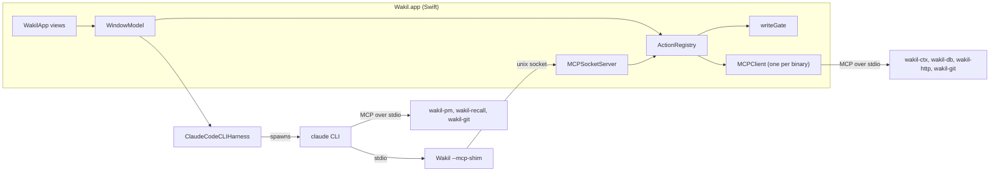

# Wakil architecture

The map of the code, Swift and Go. Every fact here names the file or type it comes from, so it can
be checked; where a rule exists, it names the test that enforces it or says *convention*.

Read in this order:

| File | Answers |
|---|---|
| this file | What the pieces are and how they talk |
| [runtime.md](runtime.md) | Who creates and owns what, how Go binaries are found, and the shutdown order |
| [flows.md](flows.md) | What happens, function by function, on a click, an agent tool call and an org switch |
| [wakilkit.md](wakilkit.md) | Every `WakilKit` folder: its job, key types, what it may use, its tests; the layering rules |
| [wakilapp.md](wakilapp.md) | The executable: `main.swift`'s modes, the scene, the canvas and each view |
| [go.md](go.md) | Every Go binary and its tools; `internal/wakilcore` by area; the Go layering rules |
| [state.md](state.md) | Everything on disk and in the Keychain, what lives only in memory, what an org switch resets |
| [testing.md](testing.md) | The test suites, the structural tests, e2e, acceptance runbooks and the make targets |

Then `CONTRIBUTING.md` at the repository root: where new code goes, recipes, and the tests each
change needs.

## The pieces

- **`WakilApp`** (`app/Sources/WakilApp/`) draws. Its views read `WindowModel` and dispatch through
  it. It has no test target, so nothing worth asserting is decided there.
- **`WakilKit`** (`app/Sources/WakilKit/`) is everything else in Swift: `WindowModel`, the stores,
  `ActionRegistry`, the gate, the MCP client and server, and the harness.
- **`ActionRegistry.dispatch`** is the single path for every state change, whether a control, the
  agent, or a `--dispatch` script asked. It asks `writeGate` first and journals every outcome.
- **The Go binaries** (`cmd/`, `internal/`) are headless capabilities behind MCP. The window starts
  four of them (`WakilWiring.build`). The agent's `claude` process starts the agent-facing ones
  (`agentFacingServers`). `wakil-git` is started by both.
- **The agent** is the `claude` CLI, driven by `ClaudeCodeCLIHarness` (`Harness/`). It reaches
  Wakil's own actions only through the shim.

## How they talk

- **MCP over stdio, newline-framed JSON-RPC, for every Go binary.** `MCPClient`
  (`MCP/MCPClient.swift`) spawns one binary, performs the `initialize` handshake in `start()`, and
  calls tools with `callTool`. Each binary serves with `mcp.StdioTransport`.
- **The shim.** The `claude` CLI can only spawn stdio MCP servers, and the app is already running.
  So the agent's MCP config (`agentMCPConfigJSON`) names the app's own executable with
  `--mcp-shim --socket <path>` as the server called `wakil`. `runShim` (`MCP/Shim.swift`) copies
  bytes between its stdio and its agent session's own unix socket and parses nothing. `MCPSocketServer`
  (`MCP/MCPServer.swift`) answers each frame on the socket with `handle`.
- **The agent's tools are the registry's actions.** `tools/list` on the socket is the registry's
  action set, plus three hand-written tools answered in the window: `read_pane` (what a pane shows,
  from `PaneStore`), `read_layout` (what is on screen, from `LayoutStore`), and `approve_tool_use`
  (the CLI's permission prompt, answered by `permissionDecision`).
- **The `wakil` CLI** is run as a plain subprocess by the window to read and mint account
  credentials (`WakilCLICredentialsLookup`, `WakilCLIProviderMint`).

## Where to go next

- `docs/wakil/north-star.md` — the charter. §4 Invariants are binding; §9 is the glossary.
- `PRODUCT.md` §Interaction Rules — how every control behaves.
- `docs/wakil/decisions.md` — decision records.
- `docs/wakil/org-and-provider-model.md` — organisations, providers and accounts.
- `docs/agents/workflow.md` — the five rungs (Design → Plan → Build → Cover → Walk).
- `docs/superpowers/specs/` — phase specs, with the reasoning behind each piece.
- `CONTRIBUTING.md` — where code goes, and the tests each change needs.
